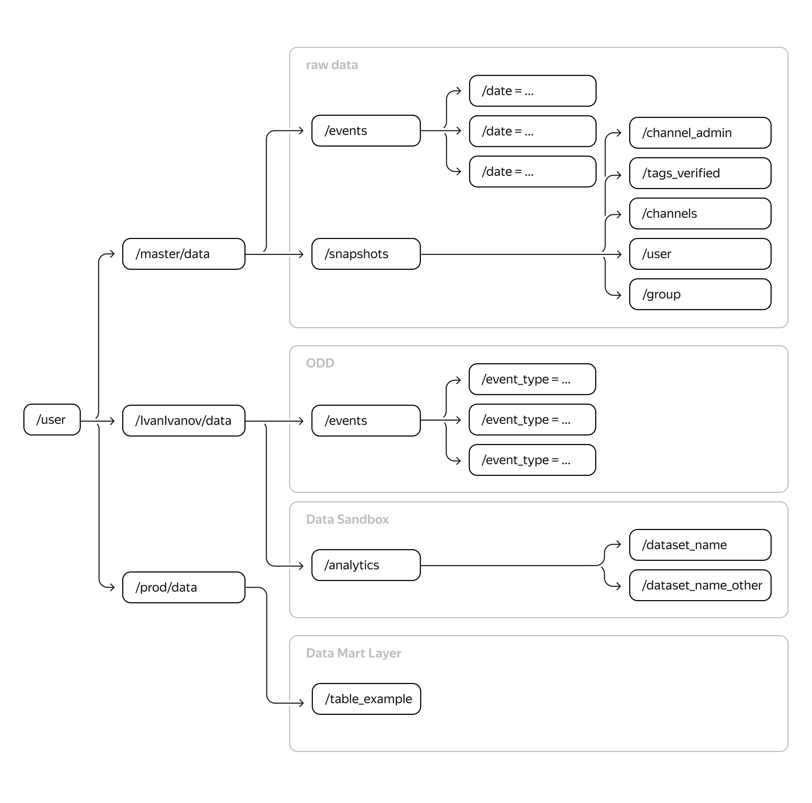

# Проект организации Data Lake для соцсети

Соцсеть, для которой вы построили Data Lake, развивается — пробный запуск в Австралии оказался удачным. Команда готовится к разработке обновлений. Значит, структуру хранилища предстоит переделать, а данные — дополнить. Этим вы и займётесь в проекте.

## Описание задачи

Коллеги из другого проекта по просьбе вашей команды начали вычислять координаты событий (сообщений, подписок, реакций, регистраций), которые совершили пользователи соцсети. Значения координат будут появляться в таблице событий. Пока определяется геопозиция только исходящих сообщений, но уже сейчас можно начать разрабатывать новый функционал. 

В продукт планируют внедрить систему рекомендации друзей. Приложение будет предлагать пользователю написать человеку, если пользователь и адресат:
- состоят в одном канале,
- раньше никогда не переписывались,
- находятся не дальше 1 км друг от друга.
- 
При этом команда хочет лучше изучить аудиторию соцсети, чтобы в будущем запустить монетизацию. Для этого было решено провести геоаналитику:
- Выяснить, где находится большинство пользователей по количеству сообщений, лайков и подписок из одной точки.
- Посмотреть, в какой точке Австралии регистрируется больше всего новых пользователей.
- Определить, как часто пользователи путешествуют и какие города выбирают.

Благодаря такой аналитике в соцсеть можно будет вставить рекламу: приложение сможет учитывать местонахождение пользователя и предлагать тому подходящие услуги компаний-партнёров. 

В проекте используются почти те же данные, что и в спринте. Есть только два изменения:
1. В таблицу событий добавились два поля — широта и долгота исходящих сообщений. Обновлённая таблица уже находится в HDFS по этому пути: `/user/master/data/geo/events`.
2. У вас теперь есть координаты городов Австралии, которые аналитики собрали в одну таблицу — geo.csv. Скачайте её и добавьте в HDFS. Для этого загрузите таблицу в Jupyter, воспользовавшись командой `copyFromLocal` в терминале.

## Описание реализации проекта

Проект Data Like на базе HDFS реализован на Python с применением ООП. В качестве инструментов автоматизации процессов проекта использованы PySpark, Hadoop, Yarn, Airflow. 

Каждой витрине проекта соовтетствует один класс:
- Класс `UsersCities` - Первая витрина, представляющая информацию о действиях в разрезе пользователей.
- Класс `EventsCities` - Вторая витрина, представляющая пользователей в разрезе зон.
- Класс `RecommendedFriends` - Третья витрина для рекоммендаций друзьям.

Все классы, связанные свитринами, явлюятся дочерними относительно родительского класса `DistancesCities`. Родительский класс содержит несколько базовых методов и параметров, используемых дочерними классами. Все классы реализованы в файле [`class_library.py`](src/scripts/class_library.py), который вместе с системным файлом [`__init__.py`](src/scripts/__init__.py) и файлами джобов, находятся в папке [`scripts`](src/scripts). Файл [`__init__.py`](src/scripts/__init__.py) содержит указатели на классы для упрощения взаимодействия с ними. Каждый файл с джобой, связан только с одним классом и витриной:
- Файл [`users_cities.py`](src/scripts/users_cities.py) содержит одноименную джобу `users_cities`, связан с классом `UsersCities` и первой витриной. 
- Файл [`events_cities.py`](src/scripts/events_cities.py) содержит одноименную джобу `events_cities`, связан с классом `EventsCities` и первой витриной. 
- Файл [`recommended_friends.py`](src/scripts/recommended_friends.py) содержит одноименную джобу `recommended_friends`, связан с классом `RecommendedFriends` и первой витриной.

Автоматизация взаимодействия классв, джобов и витрин реалзиована через единственный даг `datalake_hdfs_etl` в файле [`datalake_hdfs_etl_dag.py`](src/dags/datalake_hdfs_etl_dag.py) разположенном вмиесте с системным файлом [`__init__.py`](src/dags/__init__.py) в папке [`dags`](dsrc/ags). В даге для каждой джобы создан отдельный одноименный таск.

### Схема проекта

```
src/
    |---- __init__.py
    |
    |---- script/
    |       |---- __init__.py
    |       |---- class_library.py
    |       |---- users_cities.py
    |       |---- events_cities.py
    |       |---- recommended_friends.py
    |
    |---- dags/
            |---- __init__.py
            |---- datalake_hdfs_etl_dag.py
```

### Форматы таблиц проекта

Во всех слоях Data Lake, кроме Raw data будут использоватья таблицы в формате Parquet, т.к. он наиболее оптимально подходит для хранение и обработки нестркутрированных больших данных. В слое сырых данных будут использоваться таблицы в их исходных форматах, например, в CSV, что позволит загружать их максимально быстро в этот слой из источников.

## Резальтаты анализа проекта

### Схема Data Lake проекта


<center><b>Рисунок 1</b>. Схема Data Lake проекта</center>

Слои Data Lake проекта:
1. **Raw data** (сырые данные)
    1. `/user/master/data/events` - Таблицы событий.
    1. `/user/master/data/snapshots` - Таблицы снапшотов (мгновенных снимков таблиц, фактически бэкапов таблиц).
1. **ODD** (Operation Data Demention - операционый уровень предобработанных данных)
    1. `/user/evgtelegra/data/events` - Предобработанные таблицы событий.
1. **Data Sandbox** (среда для экспериментов аналитиков и спеиалистов по данным)
    1. `/user/evgtelegra/data/analytics` - Таблицы с экспериментами аналитиков и спеиалистов по данным.
1. **Data Mart Layer** (слой витрин данных)
    1. `/user/prod/data` - Таблицы витрин данных.

### Расчет расстояния между двумя объектами на Земле

Для расчета расстояний требуется:
1. В исходном файле с данными городов требуется в столбцах с числами разграничитель целой и дробной части с запятой (`,`) заменить на точку (`.`).
2. Все значения координат в обеих таблицах заменить с градусов на радианы.
3. Перевести на язык PySpark формулу расчета расстояния. Для перевода в PySpark наиболее удачной является формула:

$$
φ = φ_2 - φ_1
$$
$$
λ = λ_2 - λ_1
$$
$$
a = \sin{(φ / 2)}^2 - \cos{(φ_1)} * \cos{(φ_2)} * \sin{(λ / 2)}^2
$$
$$
d = (2 * \arcsin{(\sqrt{a})}) * r
$$

где (в скобках названиея столбцов таблиц с данными о событиях и городах):

- $φ_1$ - широта первой точки (`lat_1`);
- $φ_2$ - широта второй точки (`lat_2`);
- $λ_1$ - долгота первой точки (`lng_1`);
- $λ_2$ - долгота второй точки (`lng_2`);
- $r$ - радиус Земли, примерно равный 6371.0088 км.

### Выбор метода определения домашнего города

Соласно условию проекта, домашний город пользователя определяется по наличию непрерывной цепочки действий пользователя за 27 дней в одном городе. При этом предлагается воспользоваться возможностью выбрать самостоятельно выбрать вариант определения домашнего адреса. В связи с этим, предлагается вариант определения домашнего адреса по максимальному количество эвентов пользователя в городе.

### Рзработка алгоритма функционирования класса `RecommendedFriends` для витрины рекомендаций друзей

Предлагается схема функционирования класса:
1. Найти каналы `subscription_channel` с более чем одним подписчиком `user`.
2. Создать список пользователей в виде пар `user` - `subscription_channel` из подписчиков каналов, в которых более одного подписчика.
3. Образовать все возможные варианты пар из всех пользователей, подписанных к одному каналу.
4. Сделать список всех уникальных личных переписок из `message_from` и `message_to`.
5. Выбрать из списка пар подписантов к каналам те, которые не были найдены в личных переписках.
6. Определить расстояние между участниками пар подписчиков одного канала, не переписывающихся ранее. Оставить только те пары, участники которых расположены на расстоянии не более 1 км.
7. Определить по первому участнику пары город и локальное время.

В целях данного проекта в классе `RecommendedFriends` принимаем предположение о том, что все пользователи соцсети находятся в Австралии. В связи с этим, если у пользователей нет геоданных, предполагаем, что они с высокой вероятностью находятся в Сиднее - самом густонаселенном городе Австралии. (координаты Сиднея (Sydney) в градусах:-33.865, 151.2094, а в радианах: -0.5910557804826516; 2.6391018264753536). Это не идеальное, но интересное решение. В ином случае отсекать пары без геоданных. В имеющемся сэмпле без этого нет пар с расстоянием, меньше 1 км

### Название врменных зон для витрины в разрезе пользователей 

В результате анализа таблицы с городами выявлено не соответствие некоторых городов названиям временных зон в Австралии. Например. несколько городов, перечисленных в таблице и названия временных зон:
- Townsville - 'Australia/Brisbane'
- Cairns - 'Australia/Brisbane'
- Gold Coast - 'Australia/Brisbane'
- Toowoomba - 'Australia/Brisbane'
- Rockhampton - 'Australia/Brisbane'
- Mackay - 'Australia/Brisbane'
- Ballarat - 'Australia/Melbourne'
- Bendigo - 'Australia/Melbourne'
- Cranbourne - 'Australia/Melbourne'
- Launceston - 'Australia/Melbourne'
- Wollongong - 'Australia/Melbourne'
- Bunbury - 'Australia/Perth'
- Maitland - 'Australia/Sydney'
- Newcastle - 'Australia/Sydney'
- Cairns - 'Australia/Sydney'

### Создание "плоского" справочника пользователей в таблице событий

Информация о пользователях, совершивших активное действие, храниться в разных полях:
- `event.message_from` - отправитель сообщения.
- `event.reaction_from` - автор реакции на сообщение.
- `event.user` - пользователь, совершивший действие.

Для упрощения работы с этими полями в рамках данного проекта предлагается объединить эти поля в одно с указанием в отдельном поле название исходного поля расположения идентификатора пользователя.